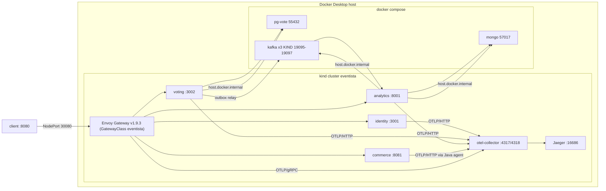

# Walking skeleton — architecture

## Runtime topology

Pods reach host-published ports through `hostAliases` (192.168.65.254 →
host.docker.internal, `deploy/helm/eventista/values-kind.yaml`). EXTERNAL
Kafka listeners advertise `localhost`, so a dedicated KIND listener was added
(`docker-compose.yml:87-135`).

## Boundaries

| Service | Owns | Never owns | Store |
|---|---|---|---|
| identity | token issuance/verification contract, users | ballots, orders, projections | none (Phase 1) |
| voting | ballot truth, quota later, outbox | payments, inventory, activity feed | pg-vote (`ballot_stub`, `outbox`) |
| commerce | inventory, orders, payments later | vote truth | none (Phase 1; pg-app from T3.6) |
| analytics | activity feed, aggregates | any source-of-truth state | Mongo `analytics.activity` |

Rules exercised here:

- **Contracts are the only seam.** Backend paths come from
  `contracts/openapi/*`; Kafka payload/headers from `contracts/asyncapi.yaml`.
  The gateway namespacing (`/api/v1/{service}/...`) is public routing, not a
  second contract (`gateway.yaml:60-153`).
- **No synchronous vote↔commerce call.** Inventory is composed by the client;
  the systems meet only through contracts and events.
- **Services are the auth authority.** The gateway filters cheaply; every
  protected service verifies JWTs locally (`jwt-verifier.service.ts:23-69`).
- **Analytics is a projection.** A Mongo outage degrades reads/readiness; it
  never affects vote correctness (`main.py:191-195,237-259`).

## Integration points

| Seam | Producer | Consumer | Shape |
|---|---|---|---|
| HTTP `/api/v1/{identity,votes,commerce,analytics}/...` | client/k6 | Envoy → service | OpenAPI, rewritten prefix |
| JWT + JWKS | identity | Envoy, identity, voting | RS256, `iss`, `aud`, thumbprint `kid` |
| `eventista.vote.cast` | voting relay | analytics group `analytics` | JSON payload + AsyncAPI `commonHeaders` |
| OTLP | 4 services + Envoy | collector → Jaeger | W3C `traceparent` |
| Prometheus | each service | operator/port-forward | `/metrics` (never routed) |

## Patterns in place

- **Transactional outbox** — state + event in one tx; poller claims with
  `UPDATE…RETURNING … FOR UPDATE SKIP LOCKED`; at-least-once (ADR-0003).
- **Idempotent consumer** — `_id` = message id, upsert, commit after write.
- **Local JWT verification** — cached JWKS, refresh on unknown `kid`
  (ADR-0007). Edge pre-filter is optional.
- **Projection reads** — keyset cursor on `(occurredAt, _id)`; Mongo
  aggregation for votes-per-minute.
- **RED + split probes** — bounded labels only; liveness never touches a
  datastore; readiness does (`main.py:231-259`, voting health controller).

## Structural limits (Phase 1, by design)

- Single replica per service; identity keypair is per process, so it cannot
  scale out until Phase 4 replaces the mock IdP.
- Envoy rate limits are local per replica; no global quota.
- No NetworkPolicy/mTLS yet; in-cluster traffic is trusted (gate 11 later).
- Compose datastores are single-instance local dependencies; kind workloads
  are the only thing being orchestrated.
- Commerce is DB-less, so the "DB span" in the trace is voting's PG query.
