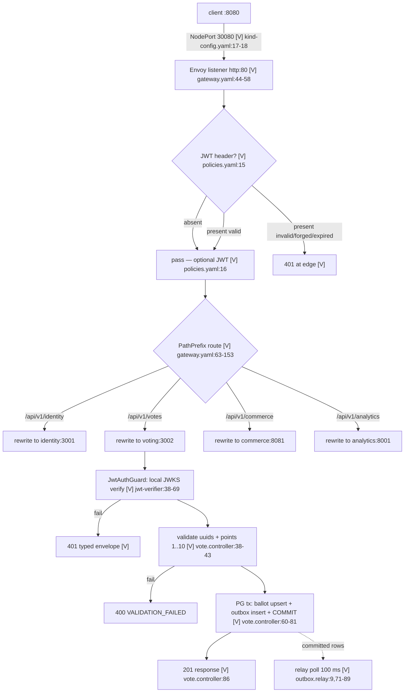
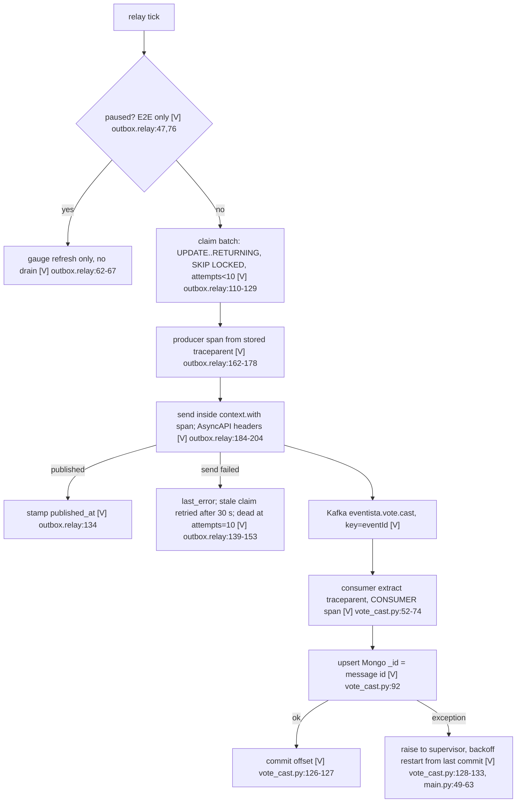
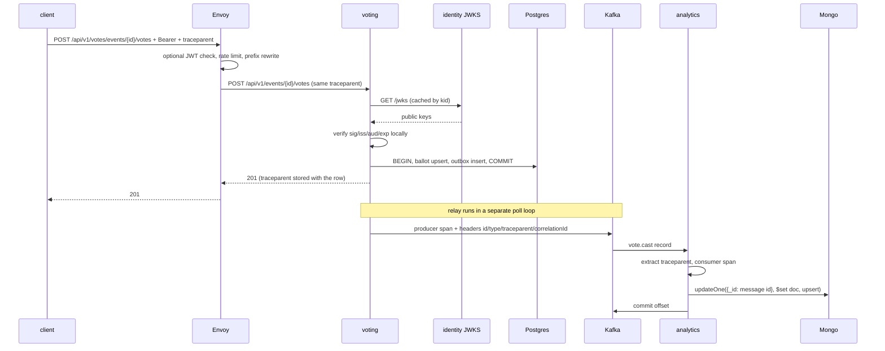

# Walking skeleton — full flow

## A. Purpose

Prove the platform before the domains: a contract-shaped HTTP call crosses the
gateway into a service and a datastore, and one accepted vote travels through a
transactional outbox and Kafka into an idempotent projection — all in one
trace. Actors: fan/k6 client, operator (`make`), analytics consumer.

## B. Execution flow

### B1. Synchronous request (vote shown; all routes share the edge path)

Rate limit sits on every route (`policies.yaml:25-45`): analytics 60/min,
others 600/min, **per Envoy replica**; excess → 429.

### B2. Asynchronous event (vote.cast → analytics)

If no `id` header/payload id is present the consumer logs and skips
(`vote_cast.py:56-59`). The activity feed reads Mongo (`main.py:271-306`);
votes-per-minute aggregates by minute (`main.py:206-228,309-335`).

## C. Sequence

Error sequence: forged/expired token → Envoy 401 (Envoy body, not the service
envelope); invalid body → service 400 envelope; PG down during vote → 500
(no typed 503 on this path yet); Mongo down → analytics readyz 503 and
activity 503 `DEPENDENCY_UNAVAILABLE`.

## D. Critical decisions (Level 3)

1. **One transaction for state + event** (`vote.controller.ts:60-81`). Ballot
   upsert and outbox insert commit together. Never commit then publish from the
   request path — a crash between the two loses the event.
2. **Claim-then-send, at-least-once** (`outbox.relay.ts:110-160`). The claim
   (attempts++, claimed_at) commits *before* publishing. A crash after publish
   but before `published_at` re-publishes later; duplicates are the accepted
   cost. After 10 attempts the row is parked and never auto-retried — there is
   **no DLQ/alert** yet.
3. **Stale-claim window = 30 s** (`outbox.relay.ts:10`). A row claimed by a dead
   relay is retried only after 30 s; this bounds duplicate latency, not
   duplicate possibility.
4. **Trace continuity is carried in the row** (`vote.controller.ts:47-49`,
   `outbox.relay.ts:166-178`). The HTTP span's `traceparent` is stored at
   insert and rehydrated by the relay. The Kafka send must run inside
   `context.with(producer span)`; otherwise KafkaJS instrumentation starts a
   root trace and overwrites the header — the consumer then links to the wrong
   trace (`outbox.relay.ts:198-204`).
5. **Consumer commit-after-write, fail-closed** (`vote_cast.py:124-133`).
   Commit only after the Mongo write. Any exception is re-raised so the
   supervisor restarts from the last commit (redelivery). A permanently bad
   record loops with backoff; DLQ is Phase 5.
6. **Idempotency key = event-message id** (`vote_cast.py:56,92`). `_id` is the
   message id, `$set` excludes `_id` (immutable), duplicate delivery is a
   no-op. The activity feed, not correctness, depends on Mongo.
7. **Edge JWT is optional and not the authority** (`policies.yaml:15-23`).
   Missing token passes (public reads), invalid token is 401 at the edge, and
   every protected service re-verifies locally from cached JWKS
   (`jwt-verifier.service.ts:23-69`). The mock IdP signs with the real RS256
   contract (`jwt-keys.service.ts:35-70`); only OAuth is absent.
8. **Public paths are namespaced, backends keep contract paths**
   (`gateway.yaml:60-153`). `/api/v1/{segment}/x` → `/api/v1/x`. A route that
   skips `ReplacePrefixMatch` delivers the wrong path and 404s.
9. **Readiness reflects real dependencies; liveness does not**
   (`main.py:231-259`). Mongo ping or consumer crash → 503 readiness. Voting's
   readyz pings PG and returns 503 on failure. Commerce/identity are stateless
   in Phase 1 and always ready.
10. **Local rate limits are per proxy replica** (`policies.yaml:38-44`).
    Two Envoy pods allow twice the configured rate; global limits are a Phase 4
    decision.

## E. Source mapping

| Step | File:line | Symbol | Responsibility | Task |
|---|---|---|---|---|
| Cluster/port map | `deploy/helm/kind-config.yaml:15-26` | kind nodes | pin v1.34.2, 8080→30080 | T1.1 |
| Image build/load | `Makefile:94-98` | `kind-load` | 4 images → nodes | T1.1 |
| Release | `Makefile:100-107` | `deploy-kind` | EG + chart install | T1.2 |
| Edge routing | `deploy/helm/eventista/templates/gateway.yaml:44-153` | Gateway/HTTPRoutes | listener, rewrite, backends | T1.2 |
| Edge JWT | `deploy/helm/eventista/templates/policies.yaml:1-24` | SecurityPolicy | optional pre-filter | T1.3 |
| Rate limits | `policies.yaml:25-45` | BackendTrafficPolicy | 600/60 per minute local | T1.2 |
| Workloads/env | `templates/services.yaml:1-128` | Deployments/Services | ports, probes, env, hostAliases | T1.2 |
| Token mint | `services/identity/src/auth/auth.controller.ts:25-58` | `testToken` | dev tokens gated by AUTH_MODE | T1.3 |
| Keypair/JWKS | `services/identity/src/auth/jwt-keys.service.ts:35-70` | `JwtKeysService` | RS256, thumbprint kid | T1.3 |
| Vote handler | `services/voting/src/vote/vote.controller.ts:27-87` | `castVote` | validate, verify, one tx | T1.5 |
| Schema bootstrap | `services/voting/src/db/db.service.ts:22-54` | `bootstrapSchema` | ballot_stub + outbox DDL | T1.5 |
| Relay claim/send | `services/voting/src/outbox/outbox.relay.ts:110-208` | `drain/publishRow` | claim, spans, headers | T1.5 |
| Consumer | `services/analytics/app/consumers/vote_cast.py:50-136` | `process_record/run_consumer` | extract, upsert, commit | T1.5 |
| Analytics HTTP | `services/analytics/app/main.py:123-335` | middleware/routes | logs, RED, feed, aggregates | T1.6 |
| Commerce stub | `services/commerce/.../inventory/InventoryController.java:21-49` | `inventory` | contract route, no DB | T1.6 |
| Commerce logs | `services/commerce/.../common/ObservabilityFilter.java:37-59` | filter | request id + JSON fields | T1.6 |
| Async gate | `scripts/e2e.sh:115-139` | e2e | doc <1 s, pause/resume | T1.5 |
| Trace gate | `scripts/e2e.sh:141-177` | e2e | gateway+service+pg+consumer | T1.4 |
| Smoke/limits | `load/k6/smoke.js:15-94` | k6 | 10 RPS, forged 401, 429 | T1.2 |

## F. Production debugging guide

| Symptom | Start at | Then |
|---|---|---|
| 401 on a call with a token | response body: Envoy text vs `{code,message,requestId}` | Envoy → `policies.yaml:15` + JWKS URL; service → `jwt-verifier.service.ts:38`, check `JWT_ISSUER/AUDIENCE/JWKS_URL` env |
| Vote 400 | `vote.controller.ts:38-43` | uuid shape, `points` integer 1..10 |
| Vote 500 | voting logs `request.rejected` + stack | PG connectivity (`db.service.ts:14`), pool exhaustion (max 10) |
| 201 but analytics never updates | voting `/metrics` `outbox_backlog`, `__test/relay/backlog` | relay logs `outbox.published` → Kafka reachable → analytics logs `vote_cast.processed` → consumer lag |
| Backlog grows while relay unpaused | `outbox.relay.ts:139-153` `last_error`/attempts | dead rows have attempts=10; fix cause then reset attempts manually |
| Async span in a different trace | relay `outbox.relay.ts:198-204` sends outside the span; consumer `vote_cast.py:52` | inspect header `traceparent` on the Kafka record; producer span must be active during send |
| 429 unexpectedly | `policies.yaml:43` | bucket refill 1/s (60/min); per-replica buckets multiply; wait or scale |
| Analytics readyz 503 | `main.py:237-259` | Mongo ping vs `consumer_ok`; check pod logs `kafka.consumer_crashed` |
| Host :8080 reset/timeout | Docker Desktop port proxy | restart the kind control-plane container; `docker port eventista-control-plane` |

## G. Ownership checklist

- **Verified [V]** — `make e2e` on v1.34.2: trace contains Envoy + voting +
  `pg.*` + analytics consumer spans; doc visible 250–840 ms across runs
  (`scripts/e2e.sh:141-177`; observed output in `plans/phases/phase-1/result.md`).
  Question: *which span proves the DB hop, and which proves the async hop?*
- **Verified [V]** — forged token → 401 at the edge; analytics 60/min burst →
  429; edge `/metrics` and `/healthz` → 404 (`smoke.js`, observed).
- **Verified [V]** — two Envoy replicas served the same token 20/20 times with
  no stickiness (manual run; result.md).
- **Assumed** — expired-token rejection at the edge (Envoy's standard exp
  check; e2e only tampers the signature). Read `policies.yaml:15-23` and know
  why `optional: true` still rejects present-but-invalid tokens.
- **Assumed** — local rate-limit refill is 1/s and buckets are per replica
  (`policies.yaml:38-44`); only the burst behavior was observed.
- **GAP** — poison-record behavior: raising in `vote_cast.py:128-133` restarts
  the consumer and redelivers from the last commit; nobody has run a
  permanently failing record. Ask: *where does it loop, and what alerts?*
- **GAP** — consumer crash between Mongo write and commit duplicates the
  upsert; harmless by `_id`, but unexercised (`vote_cast.py:92,126`).
- **GAP** — identity keypair is generated per process
  (`jwt-keys.service.ts:35-40`); a second identity replica would serve a
  different JWKS. Phase 1 runs one replica.
- **GAP** — outbox attempts=10 parks a row with no DLQ/alert
  (`outbox.relay.ts:139-153`); the async path silently stalls for that event.
- **Risk** — Docker Desktop published-port proxy occasionally blackholes the
  kind NodePort until the node container is restarted; see result.md.
