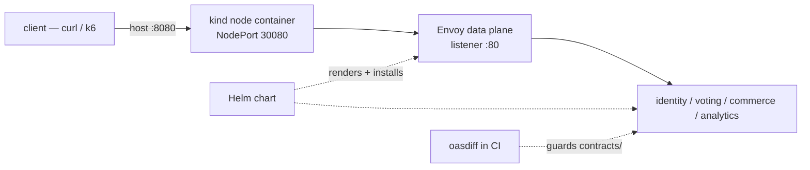

# Tooling primer — Envoy Gateway, Helm, kind, k6, oasdiff

> Beginner crib sheet. Goal: in ~60 minutes you can read every tool-related
> file in this repo and review a change to it without guessing.
> This is a learning document, not a phase Explain gate.

## 0. The one-page mental model

All five tools answer one question each:

| Tool | One-line job | In this repo |
|---|---|---|
| **kind** | Runs a real Kubernetes cluster inside Docker on your laptop | `deploy/helm/kind-config.yaml`, `Makefile:88-98` |
| **Helm** | Renders + installs Kubernetes YAML as a versioned "release" | `deploy/helm/eventista/**`, `Makefile:100-106` |
| **Envoy Gateway** | The HTTP entry point: routing, JWT pre-check, rate limits, tracing | `deploy/helm/eventista/templates/{gateway,policies}.yaml` |
| **k6** | Sends load and asserts responses/limits | `load/k6/smoke.js`, `Makefile:108-109` |
| **oasdiff** | Fails CI when an OpenAPI change breaks clients | `contracts/baseline/`, `Makefile:64-71` |

How they connect:



Layer separation to keep in your head:

- kind = the cluster, Helm = the installer, Envoy Gateway = the traffic door.
- k6 = the traffic generator; oasdiff = the API contract guard.
- None of them contain business logic. All business logic is in `services/`.

Command index: `make help`.

## 1. Envoy Gateway

### Mental model

Envoy Gateway is a Kubernetes **control plane** for **Envoy** (the proxy that
actually handles traffic). You declare Gateway API resources; the controller
translates them into Envoy config.

Terms you must know:

| Resource | Meaning here |
|---|---|
| `GatewayClass` | "Use the Envoy Gateway controller for this class" — `gateway.yaml:33-43` |
| `EnvoyProxy` | How the Envoy deployment is built (Service type, telemetry) — `gateway.yaml:2-31` |
| `Gateway` | The listener: protocol, port — `gateway.yaml:45-59` |
| `HTTPRoute` | Path match → backend Service — `gateway.yaml:63-153` |
| `SecurityPolicy` | Edge JWT validation — `policies.yaml:5-24` |
| `BackendTrafficPolicy` | Per-route rate limit — `policies.yaml:28-45` |

The installed controller itself is not in this chart; `Chart.yaml:5-6` says
the Envoy Gateway control plane + CRDs are installed separately by
`make deploy-kind` (`Makefile:101-103`, Helm release `eg`).

### Read `gateway.yaml` in 4 passes

1. **EnvoyProxy** (`:2-31`): `serviceType` comes from values
   (`NodePort` locally), a strategic-merge patch pins `nodePort: 30080` and
   `externalTrafficPolicy: Cluster` (`:13-24`). Tracing samples 100% and
   exports OTLP to `otel-collector` (`:25-31`).
2. **GatewayClass** (`:33-43`): `controllerName:
   gateway.envoyproxy.io/gatewayclass-controller`; `parametersRef` binds the
   `EnvoyProxy` above.
3. **Gateway** (`:45-59`): one HTTP listener on port 80, routes only from the
   same namespace.
4. **HTTPRoutes** (`:63-153`): one per service. Pattern for every route:
   match `PathPrefix /api/v1/<service>`, `URLRewrite` replaces the prefix with
   `/api/v1`, then `backendRefs` names the Service and port. Example:
   `/api/v1/votes/...` → `voting:3002` (`:86-107`).

Why the rewrite exists: public paths are service-namespaced so one Gateway can
host 4 services, while backends keep the contract path `/api/v1/...` from
`contracts/openapi/*.yaml` (`gateway.yaml:60-62`).

Edge JWT (`policies.yaml:5-24`): `optional: true` means "no token still
passes to public routes; a present-but-invalid token gets 401". Services still
verify locally — the edge check is cheap defense, not the authority (ADR-0007).

### Commands

```bash
kubectl get gatewayclass,gateway,httproute -A
kubectl -n eventista get pods
kubectl -n eventista describe httproute votes
kubectl -n envoy-gateway-system get pods              # control plane
kubectl -n eventista get pods                          # data plane (generated names)
kubectl port-forward -n eventista svc/jaeger 16686:16686
```

If `kubectl` does not see the CRDs, the `eg` Helm release is missing or failed.

### Review checklist

- Port chain consistent: kind host 8080 → node 30080 → Envoy :80.
- Every new service has an `HTTPRoute` with `parentRefs` to the `Gateway` and
  a `URLRewrite` — otherwise the backend receives a prefixed path and 404s.
- `backendRefs` name/port match `templates/services.yaml`.
- `SecurityPolicy` `targetRefs` is a Gateway (global) or specific HTTPRoute
  (narrow) — never both unintentionally.
- Rate limits are `type: Local` = per Envoy replica, so N replicas multiply
  the limit. Do not claim a global limit.
- Telemetry host/port matches the collector Service in `observability.yaml`.

### Gotcha

The NodePort patch uses `externalTrafficPolicy: Cluster` on purpose
(`gateway.yaml:18-20`): with `Local`, a NodePort can land on a node with no
Envoy pod and blackhole. Do not "simplify" it back to `Local`.

### Self-check

1. Which resource makes `/api/v1/commerce/...` reach `commerce:8081` without
   changing the backend's own route?
2. Why can Envoy reject a forged token even though it only has public keys?

## 2. Helm

### Mental model

A chart = templates + `values.yaml`. `helm template` renders locally;
`helm upgrade --install` renders and applies to the cluster, recording a
**release** you can inspect and roll back.

Merge order for this project:
chart `values.yaml` < `values-kind.yaml` (the `-f` overlay) < `--set`.

Files:

- `deploy/helm/eventista/Chart.yaml` — metadata only.
- `templates/*.yaml` — YAML with Go-template placeholders (`{{ .Values... }}`).
- `values.yaml` — defaults.
- `values-kind.yaml` — local overlay: NodePort 30080, host aliases,
  datastore URLs through `host.docker.internal`, `AUTH_MODE: test`.

Templates in this chart: `services.yaml` (4 Deployments/Services),
`gateway.yaml`, `policies.yaml`, `observability.yaml`, `_helpers.tpl`.

### Commands

```bash
helm template eventista deploy/helm/eventista -f deploy/helm/eventista/values-kind.yaml
helm lint deploy/helm/eventista
helm list -A
helm status -n eventista eventista
helm get manifest -n eventista eventista
helm rollback -n eventista eventista 1
```

`helm template` is the review tool: no cluster needed, no side effects. Diff
its output before/after a change.

### Review checklist

- A new value used in a template also exists in `values.yaml` with a sane
  default; the kind overlay overrides only what must differ.
- No secrets in values — env injection instead (check `services.yaml`).
- Namespace/name references are templated, not hard-coded, except intentional
  in-cluster FQDNs like `identity.eventista.svc.cluster.local`
  (`values-kind.yaml:11`).
- `helm template` renders without `<no value>` or `nil` surprises.
- Chart flags: `--wait` means install fails if pods never become Ready —
  keep that behavior in `deploy-kind`.

### Gotcha

`helm upgrade --install <same release>` is the idempotent path used here
(`Makefile:101-106`). Do not switch to bare `helm install` in scripts: a
second run then fails with "release already exists".

### Self-check

1. Where does the port `30080` in the Envoy NodePort come from? (Trace:
   `values-kind.yaml` → `gateway.yaml` template → `EnvoyProxy` patch.)
2. Which file would you edit to change the analytics rate limit, and which
   layer actually enforces it?

## 3. kind

### Mental model

kind runs Kubernetes **nodes as Docker containers**. Your host's Docker
publishes a few ports into the control-plane container; the cluster does the
rest. There is no registry here: images are built locally and copied in.

Config `deploy/helm/kind-config.yaml`:

- 1 control-plane + 2 workers, all pinned `kindest/node:v1.34.2` (`:14-26`).
- `extraPortMappings` (`:16-22`): host 8080 → node 30080 (Envoy),
  host 8443 → node 30081 (future TLS listener).

Pin reason: Docker Desktop's cgroup version previously refused k8s ≥ 1.35;
the approved pin (G-I) is what gates run on even if newer images boot.

### Commands

```bash
make kind-up        # create only if missing; prints context + nodes
make kind-load      # docker build 4 images, then kind load docker-image
make deploy-kind    # installs Envoy Gateway chart + this chart
kind get clusters
kind export logs ./kind-logs
kubectl -n eventista get pods -o wide
```

### Review checklist

- Config changes require **recreating** the cluster; `kind-up` will not mutate
  an existing one. Say so in the PR and update the pin consciously.
- Host/container port pairs stay consistent with `values-kind.yaml`
  (`gateway.httpNodePort: 30080`).
- After changing a service image, run `make kind-load` again — the cluster has
  no registry and does not fetch new builds by itself.
- New services must be added to `Makefile:95-98` and `SERVICE_IMAGES`
  (`Makefile:19-20`), or the pod will image-pull-fail.

### Gotcha

`kind load docker-image` copies what Docker has **now**. Forgetting the
rebuild/load step is the classic "my fix is not in the cluster" failure.

### Self-check

1. Why does `curl localhost:8080` reach Envoy inside the cluster?
2. What breaks if you add a route for a fifth service but forget `kind-load`?

## 4. k6

### Mental model

k6 is a load generator written in JavaScript. A script declares:

- **scenarios**: who runs, how often, for how long (`smoke.js:15-33`);
- **exec functions**: what one iteration does (`smokeFlow`, `burstFlow`);
- **checks**: assertions attached to responses (`check(...)`);
- **thresholds**: pass/fail rules over metrics (`smoke.js:34-38`);
- **custom metrics**: e.g. `rateLimited` counter (`smoke.js:13`).

The process exits **non-zero when a threshold fails**, which is what makes
`make smoke` a gate.

### Read `smoke.js`

| Lines | What it proves |
|---|---|
| `8-9` | Target `localhost:8080`, fixed event id |
| `11` | Expected statuses include 400/401/429 — negative paths are intentional |
| `16-25` | `smoke`: constant 10 req/s for 10 s |
| `26-32` | `burst`: 120 requests at 15 s, aimed at the analytics 60/min limit |
| `34-38` | Fails if >1% errors, <99% checks pass, or zero 429s seen |
| `41-51` | Setup mints a real dev token, then forges one by corrupting the last 4 chars |
| `55-85` | Round-robins one real GET per service; every 10th iteration asserts forged JWT → 401 |
| `87-94` | Burst loop counts 429s |

### Commands

```bash
make smoke                                   # wrapper for .tools/bin/k6 run --quiet load/k6/smoke.js
BASE_URL=http://localhost:8080 .tools/bin/k6 run load/k6/smoke.js
.tools/bin/k6 run --summary-export=out.json load/k6/smoke.js
```

Prerequisite: the edge is up (`make up` for compose, or
`make kind-up && make deploy-kind`). If `k6` is missing, the Makefile expects
it at `.tools/bin/k6` (Windows: `k6.exe`); `make tools` fetches only oasdiff.

### Review checklist

- A check asserts **body meaning**, not only `200` (see `:62`, `:65`, `:70`).
- Negative scenarios have their expected status in `expectedStatuses`, or k6
  counts them as failures.
- Thresholds are the gate; "it printed green" without thresholds is not proof.
- Scenario times do not accidentally overlap (a past bug: burst overlapped the
  smoke window and caused 429s — `docs/learning/observability.md:110`).
- Load numbers from kind are **relative** only; absolute SLO claims belong to
  the EKS runs (Q-52/G-C).

### Gotcha

k6 results are only meaningful against a deterministic dataset. Later phases
mint a fresh `event_id` per run (G-D) so per-event vote quotas reset. Do not
reuse a stale event id and blame the service.

### Self-check

1. Which threshold guarantees the burst actually hit the rate limit?
2. Why is `429` in `expectedStatuses` but still a "failure" if it never
   happens?

## 5. oasdiff

### Mental model

oasdiff compares two OpenAPI files and classifies changes. `breaking` reports
changes that can break existing clients; CI fails when any `ERR`-level change
appears:

`oasdiff breaking --fail-on ERR contracts/baseline/<svc>.yaml contracts/openapi/<svc>.yaml`

- **baseline/** = the last approved contract (`contracts/baseline/`).
- **openapi/** = the current spec (`contracts/openapi/`).
- Direction matters: first file = old, second = new.
- Exit code 1 = breaking change found; 0 = compatible.

Typical breaking changes: removing/renaming a response field, changing a type,
adding a new required request field, removing an enum value, narrowing a
status-code set. Additive optional fields are usually non-breaking.

Scope: covers the 4 OpenAPI files. AsyncAPI has a separate gate
(`scripts/asyncapi-breaking.mjs`, `Makefile:71`), not oasdiff.

### Commands

```bash
make contract                        # full gate: spectral + ownership + oasdiff x4 + asyncapi
.tools/bin/oasdiff changelog contracts/baseline/vote.yaml contracts/openapi/vote.yaml
.tools/bin/oasdiff breaking contracts/baseline/vote.yaml contracts/openapi/vote.yaml
```

`tools` (`Makefile:28-39`) downloads the pinned v1.35.0 binary into
`.tools/bin` if missing. CI does the same fetch (`.github/workflows/ci.yml:24-28`).

### Review checklist

- Baseline changes are **intentional** and in the same PR as the spec change;
  a baseline update that nobody discusses is a red flag.
- Run `oasdiff changelog` and read it: it explains the user-visible delta.
- Removing a field? It needs a migration/versioning story, not a quiet edit.
- The gate must not be weakened (`--fail-on ERR` stays; no `|| true` in CI).
- Consumer-side impact: check `contracts/event-ownership.md` and the services
  that consume the spec.

### Gotcha

The baseline is not "a copy of the current spec". It is the accepted public
contract. Regenerating it from `openapi/` without review silently disables
the gate.

### Self-check

1. Which file is "old" in `oasdiff breaking A B`?
2. Why can `make contract` pass while `make e2e` still fails?

## 6. Review recipes — changed artifact → questions to ask

| Changed file | Ask |
|---|---|
| `templates/gateway.yaml` | Does every route still rewrite? Are Service name/port correct? Listener/targetRef intact? |
| `templates/policies.yaml` | Is JWT optionality still intended? Are limits per-route and per-replica understood? |
| `values*.yaml` | Does every new key have a default? Is the kind overlay only a local delta? |
| `Chart.yaml` / release logic | Is the Envoy Gateway control plane still assumed installed? Is the release name stable? |
| `kind-config.yaml` | Port pairs consistent? Version pin change justified? Cluster recreation noted? |
| `load/k6/*.js` | Do checks assert content? Do scenarios overlap? Thresholds fail the run? Fresh data? |
| `contracts/openapi/*` | Any breaking delta vs baseline? Changelog read? Baseline intentionally updated? |
| `.github/workflows/ci.yml` | Are all gates still allowed to fail the job? |

## 7. 90-minute hands-on path (safe, local)

```bash
# 0) read the map
make help

# 1) Helm without a cluster — see what would be installed
helm template eventista deploy/helm/eventista -f deploy/helm/eventista/values-kind.yaml

# 2) cluster + workloads (needs Docker Desktop; ~16 GB free at full stack)
make kind-up
make deploy-kind

# 3) traffic through the real edge
make smoke
kubectl -n eventista get httproute

# 4) contract gate, including a deliberate failure on a temp copy
.tools/bin/oasdiff breaking contracts/baseline/vote.yaml contracts/openapi/vote.yaml  # 0
cp contracts/openapi/vote.yaml /tmp/vote-broken.yaml
# delete one response field in /tmp/vote-broken.yaml, then:
.tools/bin/oasdiff breaking contracts/baseline/vote.yaml /tmp/vote-broken.yaml        # 1

# 5) full gate
make contract
```

Teardown: `kind delete cluster --name eventista`.

## 8. Six questions you should be able to answer

1. Which layer does the JWT signature check: Envoy, the services, or both?
2. Why does an `HTTPRoute` rewrite `/api/v1/votes` to `/api/v1`?
3. What is the difference between `helm template` and
   `helm upgrade --install`?
4. Why is `kind load docker-image` required after a rebuild?
5. What makes a k6 run "fail" even if all responses were 200?
6. What exactly does the oasdiff baseline represent, and who approves it?
